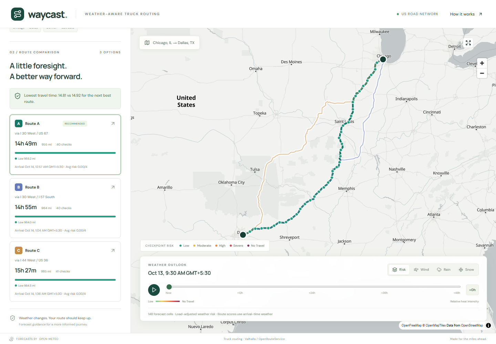

# Verification — 13 October 2026

- Backend: **60 pytest tests passed**; Django system check reported no issues.
- Frontend: **4 Vitest tests passed**; TypeScript and Vite production build passed.
- Dependency audit after updating MapLibre and Vitest: **0 known npm vulnerabilities**.
- Desktop Chromium, 1440×1000: map loaded, three real Chicago–Dallas routes,
  40/40/41 checkpoints, route selection, forecast slider, layer switch and play/pause.
- Mobile Chromium, 390×844: no horizontal overflow. Route bounds refit when the
  map container resizes.
- Production preview was tested separately on port 4173, including the bundled
  MapLibre worker. **No page JavaScript errors; zero API calls during timeline
  slider/play interactions.** Map tile requests are separate from API requests.
- Live routing: Chicago–Dallas returned three routes; Denver–Salt Lake City
  returned three; Dallas–Houston returned one with the fewer-routes explanation.
- Live ORS fallback: Chicago–Dallas returned about 966 miles and 5,413 timed
  geometry vertices. Toronto, ON was rejected as outside the USA.
- Live heatmap: Chicago–Dallas returned 148 corridor cells and 49 hourly frames.
- Staged-file check: no configured ORS key, `.env`, virtualenv, node_modules or
  test screenshots included in the source commit.

## Remaining external work

Render and Vercel account connections are needed to create the hosted services.
The repository includes their configuration; hosted behavior has **not** been
verified. The final deliverables also need the user's recorded Loom walkthrough.

The Vite build reports a large map chunk (~1.05 MB, ~287 KB gzip). It is lazy
loaded separately from the ~242 KB (~77 KB gzip) application bundle. This is a
known tradeoff of including the vector map renderer, not a build failure.
